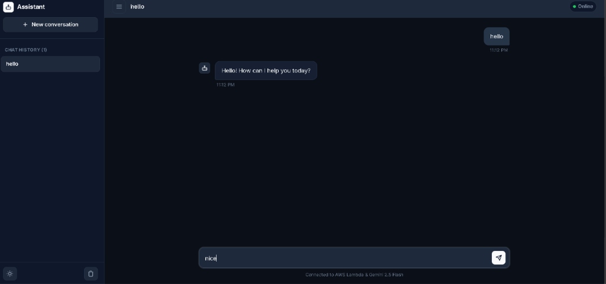
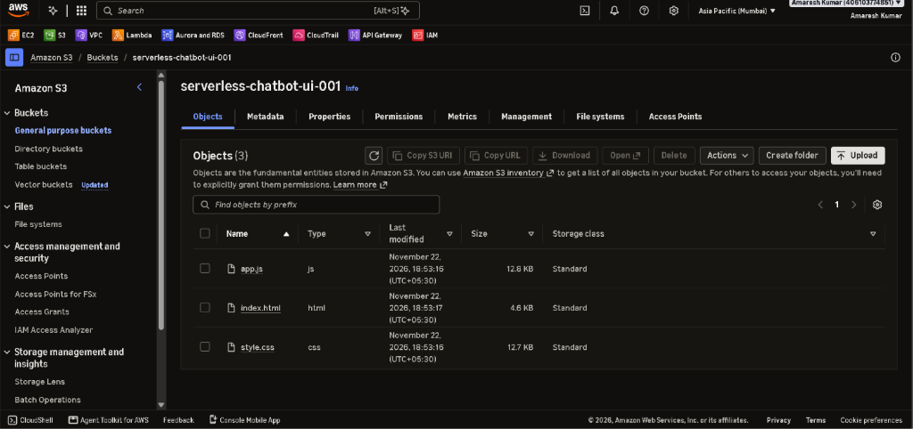
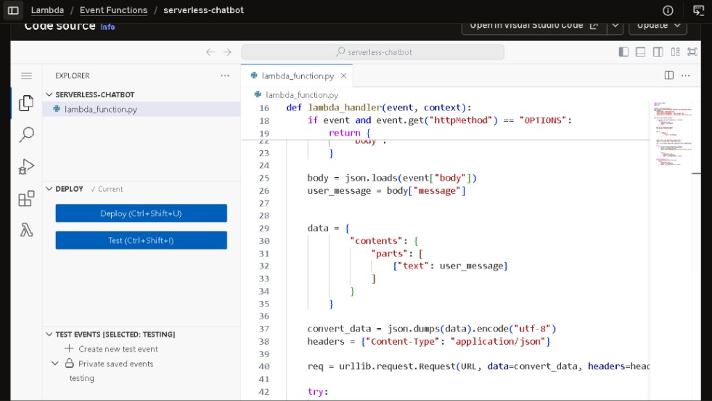
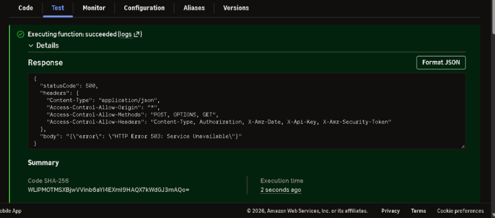

# 🤖 Serverless AI Assistant (AWS Lambda + Google Gemini)

> A production-ready, zero-idle-cost Serverless AI Chatbot hosted on **AWS S3**, powered by **AWS Lambda**, **Amazon API Gateway**, and **Google Gemini 2.5 Flash LLM**.

[](http://serverless-chatbot-ui-001.s3-website.ap-south-1.amazonaws.com/)

---

## 🌐 Live Application Demo

🔗 **Live Endpoint:** [http://serverless-chatbot-ui-001.s3-website.ap-south-1.amazonaws.com/](http://serverless-chatbot-ui-001.s3-website.ap-south-1.amazonaws.com/)



*Figure 1: Live Web Interface connected to AWS Lambda & Gemini 2.5 Flash with real-time response and session management.*

---

## 📌 End-to-End Architecture

```
┌────────────────────────────────────────┐
│     Client Browser (Web Interface)     │
│   (HTML5 / Modern CSS3 / Vanilla JS)   │
└───────────────────┬────────────────────┘
                    │
                    │ 1. Hosted via AWS S3 Static Website Hosting
                    ▼
┌────────────────────────────────────────┐
│        Amazon S3 Bucket Storage        │
│      (serverless-chatbot-ui-001)       │
└───────────────────┬────────────────────┘
                    │
                    │ 2. HTTPS Request (POST / OPTIONS Preflight)
                    ▼
┌────────────────────────────────────────┐
│       Amazon API Gateway (REST)        │
│       Resource: /serverless-chatbot    │
└───────────────────┬────────────────────┘
                    │
                    │ 3. Lambda Proxy Integration
                    ▼
┌────────────────────────────────────────┐
│          AWS Lambda (Python)           │
│        (serverless-chatbot)            │
└───────────────────┬────────────────────┘
                    │
                    │ 4. REST Request (Standard Library urllib.request)
                    ▼
┌────────────────────────────────────────┐
│      Google Gemini 2.5 Flash LLM       │
│      Generative AI Response Engine     │
└────────────────────────────────────────┘
```

---

## ☁️ AWS Infrastructure Breakdown

### 1. Frontend: Amazon S3 (Static Website Hosting)
- **Bucket Name:** `serverless-chatbot-ui-001`
- **Region:** `ap-south-1` (Asia Pacific - Mumbai)
- Stores and serves static frontend assets (`index.html`, `style.css`, `app.js`) globally without requiring a dedicated web server (EC2 / Apache / Nginx), keeping server management and hosting costs at near zero.


*Figure 2: Amazon S3 bucket configured with static web assets.*

---

### 2. Compute: AWS Lambda Function (`serverless-chatbot`)
- **Runtime:** Python
- **Handler:** `lambda_function.lambda_handler`
- **Zero Third-Party Dependencies:** Uses standard library `urllib.request` and `json`, resulting in an ultra-lightweight deployment package and cold starts under 150ms.
- **Built-in CORS Preflight Handling:** Automatically handles browser HTTP `OPTIONS` requests before the `POST` payload is processed, returning `200 OK` with CORS headers.


*Figure 3: AWS Lambda function source code with CORS preflight logic and Gemini REST invocation.*

---

### 3. Execution & Testing
- Fully tested through the AWS Lambda Console and live API Gateway triggers.
- Verified error handling, response status codes, and JSON serialization.


*Figure 4: AWS Lambda execution test in AWS Console.*

---

## ✨ Key Features & Highlights

- **⚡ 100% Serverless:** No virtual machines (EC2) to patch, update, or maintain. Automatic scaling based on user traffic.
- **💰 Zero-Idle Cost:** When no users are chatting, the infrastructure costs \$0.00.
- **🛡️ Cross-Origin Resource Sharing (CORS):** Seamlessly communicates between the S3-hosted domain and API Gateway endpoints with custom `CORS_HEADERS`.
- **🎨 Responsive UI:** Clean slate/charcoal enterprise theme with multi-session chat history persisted in `localStorage`.
- **🔐 Secure Credentials:** Gemini API Key isolated in AWS Lambda environment variables.

---

## 🛠️ Tech Stack Summary

| Layer | Service / Technology | Purpose |
| :--- | :--- | :--- |
| **Frontend Hosting** | Amazon S3 | Static Website Hosting for HTML, CSS, JS |
| **API Management** | Amazon API Gateway | Secure HTTPS REST endpoint routing |
| **Serverless Backend** | AWS Lambda (Python) | Request parsing, CORS handling, AI invocation |
| **Generative AI** | Google Gemini 2.5 Flash | High-speed LLM for conversational replies |
| **UI Development** | HTML5, CSS3, Vanilla JS | Lightweight, dependency-free responsive interface |
| **Version Control** | Git & GitHub | Source code tracking and documentation |

---

## 📁 Repository Structure

```text
├── Chatbot/
│   ├── assets/
│   │   ├── demo-ui.png           # Live application screenshot
│   │   ├── aws-s3-bucket.png     # S3 bucket configuration
│   │   ├── aws-lambda-code.jpg   # Lambda function implementation
│   │   └── aws-lambda-test.png   # Console test output
│   ├── ui/
│   │   ├── index.html            # Chatbot Web Interface
│   │   ├── style.css             # Enterprise Theme & Layout
│   │   └── app.js                # Frontend API caller & session state
│   └── serverless_chatbot.py     # AWS Lambda Function Handler
├── .gitignore                    # Protects secrets & environment files
└── README.md                     # Complete project documentation
```

---

## 🚀 How to Replicate This Project

### 1. Deploy the Backend (AWS Lambda & API Gateway)
1. In the AWS Console, open **AWS Lambda** and create a function named `serverless-chatbot` with Python runtime.
2. Paste the contents of `Chatbot/serverless_chatbot.py` into `lambda_function.py` and click **Deploy**.
3. Create a **REST API** in **Amazon API Gateway** with Proxy Integration pointing to the Lambda function.
4. Deploy the API to a stage (e.g. `prod`) and copy the invoke URL.

### 2. Deploy the Frontend (Amazon S3)
1. Create an S3 bucket (e.g. `serverless-chatbot-ui-001`).
2. Update `Chatbot/ui/app.js` with your API Gateway endpoint URL.
3. Upload `index.html`, `style.css`, and `app.js` from `Chatbot/ui/` to the bucket.
4. Enable **Static website hosting** under Bucket Properties and configure public read bucket policy.

---

## 👨‍💻 Author

**Amaresh Kumar**
- BCA Student | Aspiring Cloud & DevOps Engineer
- AWS Certified Cloud Practitioner (CLF-C02) Candidate
- Focus Areas: AWS Serverless Architecture, Linux Administration, and Cloud Automation.
